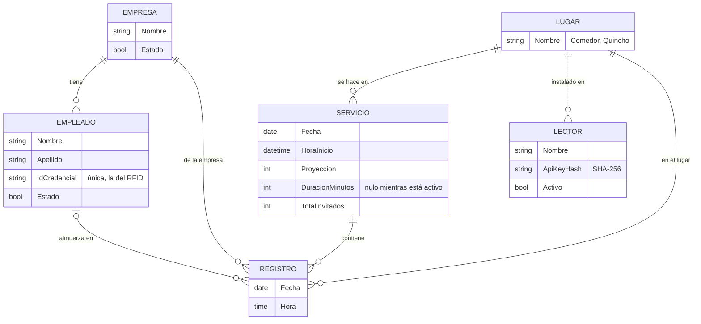
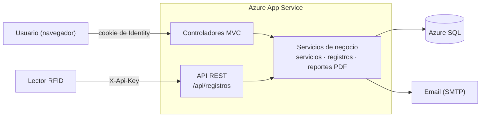

# Sistema Control de Almuerzos

Sistema web para controlar los almuerzos de un comedor industrial: registra quién come en cada servicio con su credencial RFID, lo compara con lo proyectado y arma los reportes. Es la versión web del [sistema de escritorio original](https://github.com/f-Rra/Sistema-Control-Almuerzos).

**Sitio web:** [sca-mvc-app-hndpbbgshwfnbehy.brazilsouth-01.azurewebsites.net](https://sca-mvc-app-hndpbbgshwfnbehy.brazilsouth-01.azurewebsites.net) (plan gratuito de Azure: la primera visita puede tardar unos segundos).

## Funcionalidades

- **Servicios de almuerzo en vivo**: se inicia con el lugar y una proyección, y el panel muestra el cronómetro, la cobertura y los comensales a medida que se registran.
- **Registro por credencial RFID o manual**, con las mismas reglas: empleado activo, sin duplicados y un solo servicio activo por lugar.
- **API REST para lectores de red** (por ejemplo un ESP32), con una clave por lector y documentación en Swagger. Está verificada con tests que simulan al lector; no se probó con uno físico.
- **Reportes y estadísticas**: dashboard, ranking de empresas y cuatro reportes en PDF que se pueden enviar por email.
- **Administración** de empresas, empleados, lectores y usuarios, con roles (administrador y usuario) y baja lógica.

## Capturas

| | | | |
|---|---|---|---|
|  |  |  |  |
| Dashboard con los últimos servicios | Servicio activo: cronómetro y cobertura | Registro manual por empresa | Reportes en PDF, con envío por email |
|  |  |  |  |
| Empleados con credencial RFID | Estadísticas y ranking de empresas | Alta y revocación de lectores | La API documentada en Swagger |

## Stack

.NET 9 · ASP.NET Core MVC · EF Core 9 (Fluent API, migraciones) · SQL Server / Azure SQL · ASP.NET Core Identity · Swagger · QuestPDF · MailKit · Bootstrap 5 · xUnit · Docker Compose · GitHub Actions · Azure App Service.

## Modelo de datos

Los invitados son registros sin empleado. Un empleado no puede quedar registrado dos veces en el mismo servicio: lo garantiza un índice único en la base, además de la validación de negocio. Los usuarios del sistema son las tablas de ASP.NET Core Identity.

## Arquitectura

## Decisiones técnicas

- **Dos maneras de autenticarse.** Las pantallas usan la cookie de Identity con roles; los lectores usan una clave propia, de la que en la base solo queda el hash SHA-256: se muestra una sola vez y se puede revocar al instante.
- **La base también impide el duplicado.** Un índice único filtrado por empleado y servicio respalda la validación de negocio, aunque dos registros lleguen a la vez.
- **Un solo reloj con la hora de Argentina.** La aplicación pregunta la hora a un `TimeProvider` y no a `DateTime.Now`: un servidor en la nube corre en UTC, y los tests pueden simular las 23:30 sin esperarlas.
- **Baja lógica y claves foráneas restrictivas.** Nada se borra, así el historial de asistencias no se rompe.
- **Sin claves en el repositorio.** Salen de user-secrets o de variables de entorno; si el primer administrador no tiene clave, la aplicación no arranca.

El porqué de cada una, y cómo se configura, está en [`docs/decisiones-tecnicas.md`](docs/decisiones-tecnicas.md). La API tiene su propia página: [`docs/api-lectores.md`](docs/api-lectores.md).

## Tests y CI

83 tests de xUnit: reglas de negocio sobre una base SQLite en memoria, y tests de integración que levantan la aplicación entera (protección CSRF, permisos por rol, API de lectores y Swagger). Corren en cada push con GitHub Actions.

## Autor

- Estudiante de la Tecnicatura Universitaria en Programación - UTN FRGP
- Email: [facundo.rra@gmail.com](mailto:facundo.rra@gmail.com)
