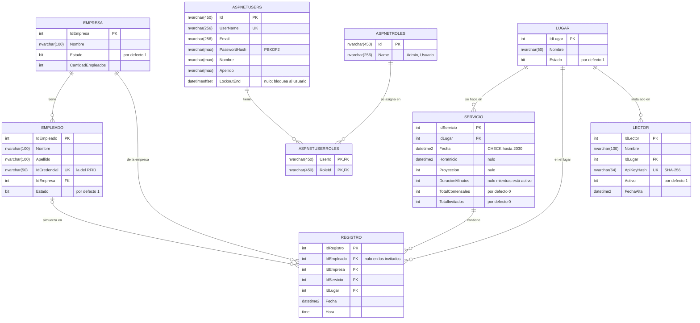

# Modelo de datos

Diagrama entidad-relación de SCA-MVC, armado a partir del modelo de EF Core (el último snapshot de las migraciones). Muestra las seis tablas del negocio y las tres de ASP.NET Core Identity que la aplicación usa para los usuarios y sus roles.

## Restricciones

| Qué | Dónde | Para qué |
|---|---|---|
| Índice único `(IdEmpleado, IdServicio)`, ignorando los nulos | `REGISTRO` | Un empleado no almuerza dos veces en el mismo servicio; los invitados (empleado nulo) no chocan entre sí |
| Índice único `IdCredencial` | `EMPLEADO` | Una credencial RFID, un empleado |
| Índice único `ApiKeyHash` | `LECTOR` | No puede haber dos lectores con la misma clave |
| `CHECK (Fecha <= '2030-01-01')` | `SERVICIO` | Evita errores de tipeo absurdos |
| Claves foráneas con `ON DELETE RESTRICT` | Todas | La base no deja borrar algo que tiene historial |
| `ON DELETE SET NULL` | `REGISTRO.IdEmpleado` | Si se eliminara un empleado, sus asistencias no se pierden |
| Trigger `TR_ValidarRegistroUnico` (`INSTEAD OF INSERT`) | `REGISTRO` | Rechaza un registro repetido. Está en `SQL/Procedimientos_Vistas_Triggers.sql`, no en las migraciones; EF Core solo lo declara con `HasTrigger` |

Las otras cuatro tablas de Identity (`AspNetRoleClaims`, `AspNetUserClaims`, `AspNetUserLogins` y `AspNetUserTokens`) y las columnas estándar de `AspNetUsers` que no se usan acá se omitieron para que el diagrama se lea.
